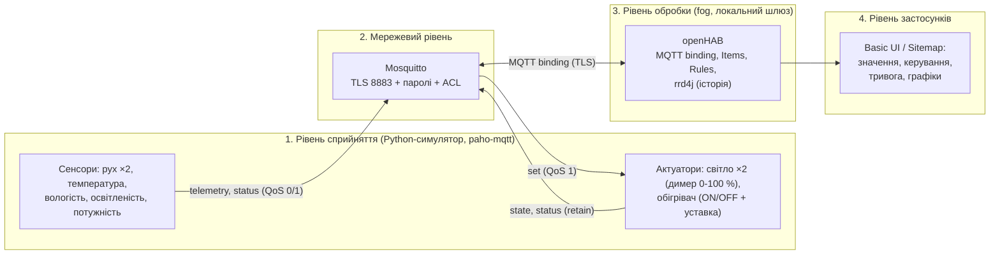

# Енергоощадна розумна квартира IoT-система (Варіант 1)

**Автор:** Єгор Кучковий, група Ік-42
**Варіант:** 1 «Енергоощадна розумна квартира»

## 1. Опис системи

Квартира з двох кімнат (вітальня, спальня) і коридору. Система:
- вмикає світло тільки коли є рух і темно, вимикає — коли руху немає 5 хв;
- знижує обігрів («Економ», 17 °C), якщо вдома нікого немає 30 хв, і повертає «Комфорт» (21 °C) при появі руху;
- стежить за потужністю мережі: > 2500 Вт понад 1 хв → тривога в UI та вимкнення обігрівача.


## 2. Архітектура (чотири рівні)



### Де обробляються дані: edge / fog / хмара
- **Edge (пристрої):** термостат обігрівача з гістерезисом ±0,3 °C працює всередині пристрою; датчик руху публікує зміни одразу, а не лише за таймером; кожен пристрій сам повідомляє `online`/`offline` (Last Will).
- **Fog (локальний сервер у квартирі — Mosquitto + openHAB):** усі правила автоматизації, агрегування присутності, історія для графіків. Причини: правила працюють без Інтернету, затримка — мілісекунди, **дані про присутність людей не залишають квартиру** (приватність).
- **Хмара:** у цій роботі не використовується. Вона мала б сенс для довгого зберігання історії й порівняння з іншими квартирами, але не для керування світлом чи захисту від перевантаження.
- **Що варто перенести на edge:** швидкий захист від перевантаження (вимикання лінії смарт-розеткою за власним порогом, навіть якщо шлюз недоступний) і антидребезг датчика руху.

### Чому MQTT, а не CoAP, HTTP, Zigbee чи LoRaWAN
У системі багато незалежних пристроїв, які мають обмінюватися подіями з кількома споживачами (openHAB, графіки, дебаг-клієнти), тому модель publish/subscribe через брокер підходить краще за запит–відповідь: пристрої не знають один про одного, а функції retain (останній стан після перезапуску) і Last Will (виявлення «мертвого» пристрою) вирішують дві реальні задачі нашого варіанта. HTTP потребує опитування й важчий для постійних з'єднань; CoAP працює поверх UDP за моделлю запит–відповідь, і для нього немає такої готової підтримки в openHAB та брокерів; Zigbee — це радіо-рівень (у реальній квартирі датчики могли б бути Zigbee, але до MQTT їх усе одно підключав би шлюз, напр. zigbee2mqtt), а LoRaWAN розрахований на рідкісні маленькі повідомлення на великі відстані, його затримка й обмеження на команди незручні для світла в квартирі.

## 3. Пристрої

| Пристрій | Тип | Топік-основа | Одиниця | Інтервал |
|---|---|---|---|---|
| `motion_living` | сенсор руху | `flat/living/motion` | 0/1 | зміна + 10 с |
| `motion_bedroom` | сенсор руху | `flat/bedroom/motion` | 0/1 | зміна + 10 с |
| `temp_living` | температура | `flat/living/temperature` | °C | 5 с |
| `hum_living` | вологість | `flat/living/humidity` | % | 5 с |
| `lux_hall` | освітленість | `flat/hall/lux` | лк | 5 с |
| `power_hall` | лічильник потужності | `flat/hall/power` | Вт | 3 с |
| `light_living` | світло з димером 0–100 % | `flat/living/light` | % | зміна + 30 с |
| `light_bedroom` | світло з димером 0–100 % | `flat/bedroom/light` | % | зміна + 30 с |
| `heater_living` | обігрівач (ON/OFF + уставка 10–28 °C) | `flat/living/heater` | °C | зміна + 30 с |

**Реалістичність даних.** Значення дає спільна фізична модель (`simulator/devices.py`, клас `Flat`), а не `random()`: температура плавно змінюється за рівнянням нагріву/тепловтрат (стала часу ≈ 33 хв, термостат з гістерезисом), вологість залежить від температури, освітленість = природне світло (плавно) + внесок увімкнених ламп, потужність = базове навантаження + цикл холодильника + лампи + 1500 Вт обігрівача (+ шум 1,5 %), рух — серії спрацювань PIR із випадковими паузами.

## 4. MQTT

### Ієрархія топіків
`<obj>/<zone>/<device>/<type>`, де `obj = flat`.

| Топік | Напрям | Формат (JSON) | QoS | retain |
|---|---|---|---|---|
| `flat/<zone>/<dev>/telemetry` | пристрій → брокер | `{"value": 23.4, "unit": "C", "ts": 1761300000}` | 0 | ні |
| `flat/<zone>/<dev>/set` | openHAB → актуатор | світло: `{"state":"ON"}` або `{"brightness":70}`; обігрівач: `{"state":"OFF"}` або `{"setpoint":17}` | 1 | ні |
| `flat/<zone>/<dev>/state` | актуатор → брокер | світло: `{"state":"ON","brightness":70}`; обігрівач: `{"state":"ON","setpoint":21.0,"heating":true}` | 1 | **так** |
| `flat/<zone>/<dev>/status` | пристрій → брокер | `online` / `offline` (звичайний текст) | 1 | **так** (+ Last Will `offline`) |
| `flat/sim/scenario/set` | тригер → симулятор | назва сценарію (текст) | 1 | ні |

### Обґрунтування QoS
- **Телеметрія — QoS 0.** Вимірювання надходять кожні 3–10 с; втрата одного значення нічого не ламає, бо за кілька секунд прийде нове. QoS 0 — найменше навантаження на мережу й брокер.
- **Команди `set` — QoS 1.** Команда «вимкнути обігрівач» не може загубитися. Дублікат (можливий при QoS 1) безпечний, бо команди ідемпотентні («встановити яскравість 70» двічі = один раз). QoS 2 не потрібен — накладні витрати без користі.
- **`state` і `status` — QoS 1 + retain.** Після перезапуску openHAB одразу отримує останній стан пристроїв і їхній статус.
- **Last Will:** кожен пристрій задає will `offline` (retain). При аварійному завершенні процесу брокер сам публікує `offline` через ~1,5 × keepalive (keepalive = 10 с). У openHAB це робить Thing пристрою `OFFLINE` (`availabilityTopic`), а індикатор у UI стає червоним.

## 5. Правила автоматизації (openHAB, Rules DSL)

| № | Умова | Дія | Демо-прискорення (`Demo_Fast = ON`) |
|---|---|---|---|
| 1а | Рух у кімнаті і освітленість < 50 лк | світло кімнати 70 % | — |
| 1б | Немає руху 5 хв | вимкнути світло кімнати | **5 хв → 30 с** |
| 2 | Нікого вдома 30 хв | режим «Економ», уставка 17 °C | **30 хв → 60 с** |
| 2 | З'явився рух у режимі «Економ» | режим «Комфорт», уставка 21 °C | — |
| 3 | Потужність > 2500 Вт понад 1 хв | сповіщення в UI + вимкнення обігрівача | **1 хв → 15 с** |

Прискорення вмикається перемикачем **«Демо-прискорення таймерів»** у Sitemap (Item `Demo_Fast`). У режимі за замовчуванням діють справжні інтервали.

## 6. Сценарії симулятора (для демонстрації кожного правила)

Запуск з початковим сценарієм (за замовчуванням `normal`) або надсилання сценарію у вже запущений симулятор:

```bash
docker compose exec simulator python devices.py --send dark_motion
```

| Сценарій | Що робить | Правило |
|---|---|---|
| `normal` | день, людина у вітальні | — |
| `dark_motion` | темно + рух у вітальні | 1а → світло 70 % |
| `bedroom_dark` | темно + рух у спальні | 1а |
| `away` | нікого вдома | 1б → світло гасне; потім 2 → «Економ», 17 °C |
| `return` | людина повернулась | 2 → «Комфорт», 21 °C |
| `overload` | +2400 Вт на 120 с | 3 → тривога + обігрівач OFF |

Тригер працює через MQTT: окремий користувач `sim_trigger` має право **лише писати** в `flat/sim/scenario/set`.

## 7. Запуск

Потрібно: Docker + Docker Compose v2, `openssl`, bash (Linux / macOS / WSL / Git Bash).

```bash
./scripts/make-env.sh        
./certs/generate.sh          
docker compose up -d         
```

1. Відкрити <http://localhost:8080>, створити адміністратора openHAB.
2. Інтерфейс: <http://localhost:8080/basicui/app?sitemap=flat>
3. Перевірити Things: Settings → Things — усі `mqtt:topic:mosquitto:*` у стані ONLINE.
4. Для демо увімкнути в Sitemap «Демо-прискорення таймерів».

## 8. Безпека

| Вимога | Реалізація |
|---|---|
| Анонімний доступ вимкнено | `allow_anonymous false` |
| Користувач на кожен пристрій, openHAB і адміна | 13 користувачів (`MQTT_PASS_<USER>` у `.env`) |
| ACL — найменші привілеї | `mosquitto/config/acl`: сенсор пише лише свою телеметрію/статус; актуатор читає лише свій `/set`; openHAB пише `/set` лише трьом актуаторам |
| TLS 8883 з власним CA | `certs/generate.sh`; клієнти перевіряють сертифікат (CA + hostname) |
| Порт 1883 закритий | слухач 1883 не створюється; опубліковано тільки 8883 (за замовчуванням на `127.0.0.1`) |
| Жодних секретів у git | паролі в `.env` (у git лише `.env.example`), ключі генерує скрипт, `.gitignore`; `broker.things` з паролем openHAB генерується з шаблону при старті |
| DoS-обмеження | `max_connections`, `message_size_limit`, `max_queued_messages`, `max_inflight_messages` |

### Модель загроз STRIDE

| Категорія | Загроза | Захід протидії |
|---|---|---|
| **S** Spoofing | Зловмисник видає себе за сенсор/openHAB або підміняє брокер | Пароль на кожного клієнта, анонімний доступ вимкнено; клієнти перевіряють сертифікат брокера (власний CA, hostname) |
| **T** Tampering | Підміна телеметрії, команда «вимкнути обігрівач» від чужого клієнта, зміна даних у мережі | ACL: запис лише у свої топіки; TLS захищає від зміни пакетів; невалідний JSON ігнорується пристроєм |
| **R** Repudiation | Неможливо довести, хто надіслав команду | Окремий користувач на кожен пристрій; `connection_messages` у логах брокера; події правил у `Last_Event`. Обмеження: немає підпису повідомлень |
| **I** Information disclosure | Підслуховування телеметрії руху розкриває, коли нікого немає вдома; витік паролів | TLS 8883; ACL обмежує читання; паролі у `.env`, не в git; порт 1883 закритий |
| **D** Denial of service | Масове підключення/потік повідомлень глушить брокер; зникнення сенсора лишається непоміченим | Ліміти з'єднань, розміру й черг у `mosquitto.conf`; `restart: unless-stopped`; Last Will + `availabilityTopic` швидко показують зникнення пристрою |
| **E** Elevation of privilege | Скомпрометований сенсор намагається керувати актуаторами або підписатися на чужі топіки | ACL за принципом найменших привілеїв; адмін-користувач окремий і не використовується пристроями; контейнери без privileged, назовні тільки 8883 і 8080 (на localhost) |

## 10. Структура репозиторію

```
├── README.md  AI_USAGE.md  docker-compose.yml  .env.example  .gitignore
├── mosquitto/        config/mosquitto.conf, config/acl, init.sh (паролі з .env)
├── certs/generate.sh (ключі і сертифікати не в git)
├── scripts/          make-env.sh, init-openhab.sh, security-demo.sh
├── openhab/          templates/broker.things.tpl
│   └── conf/         things/ items/ rules/ sitemaps/ persistence/ services/
├── simulator/        devices.py, Dockerfile, requirements.txt
└── docs/screenshots/
```
